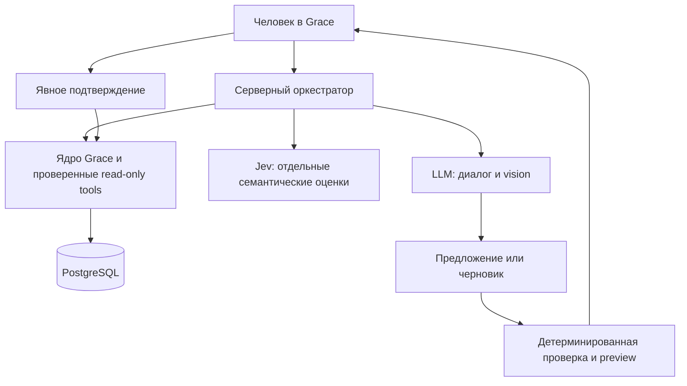

# Grace, Jev и LLM: границы взаимодействия

Дата проработки: 2026-10-08. Это проект следующего этапа, а не описание уже
включённых функций. Реализация требует принятия [SPEC-0026](specs/0026-ai-assistant-receipts.md).

## Результат для человека

В Grace можно спросить «проанализируй расходы за сентябрь» или загрузить фото
чека. Ассистент получает факты из Grace, объясняет их и предлагает следующий
шаг. Расход появляется только после отдельного подтверждения человеком.
Неотсверенные строки импорта остаются свидетельствами, не подтверждёнными
расходами: ассистент явно сообщает о неполноте истории.

## Ответственность трёх сущностей

| Сущность | Принимает | Возвращает | Решения, которые ей не принадлежат |
| --- | --- | --- | --- |
| Ядро Grace: Go + PostgreSQL | Проверенные команды пользователя, календарные периоды, записи и документы | Точные суммы, остатки, категории, происхождение фактов, кандидаты совпадений и preview | Семантические догадки не превращаются в финансовые факты |
| Jev / System One | Небольшой текстовый контекст и заданные альтернативы | Choice/Score/Noul: типизированная оценка и неопределённость | Не ведёт диалог, не объясняет месяц, не читает фото в текущем text-only API, не даёт разрешение на запись |
| LLM с vision при необходимости | Вопрос, ограниченный набор фактов/tools либо разрешённое фото чека | План чтения, понятное объяснение, извлечённый черновик | Не считает баланс, не выполняет SQL, не назначает доступ и не подтверждает расход |

Ассистент и обработка чеков зависят от финансовых модулей. Финансовые модули
не зависят от доступности Jev/LLM. React показывает ответы, формы и preview;
правила денег, совпадений, бюджета и разрешений находятся на сервере.

Стрелка от LLM к черновику обозначает результат, принимаемый оркестратором,
а не прямой доступ модели к БД. Один серверный модуль управляет вызовами,
таймаутами, контекстом и исполнением tools. Три независимых автономных
агента с общим доступом к данным здесь не нужны.

## Пример: анализ расходов

1. Сервер получает пользователя из сессии и проверяет согласие на отправку
   выбранных данных внешнему провайдеру. Черновики импорта по умолчанию исключены.
2. Период задаётся пользователем или уточняется. Go разрешает его в явные
   календарные границы Asia/Yekaterinburg. «После последней зарплаты» не
   подменяется всеми доходами или событием с неизвестным временем.
3. Сервер предоставляет LLM ограниченные read-only инструменты и валидирует
   каждый вызов. Никаких произвольных запросов к БД, внешних URL или чужих ownerId.
4. Go считает итоги и возвращает snapshot с идентификаторами фактов, периодом,
   полнотой истории и ссылками на подтверждённые события. Все числа берутся
   из этого результата; процент/сравнение тоже вычисляет Go.
5. LLM формирует структурированное объяснение: наблюдения, предположения,
   ограничения и ссылки на факты. Сервер проверяет числовые ссылки. Свободный
   текст не становится доказательством; неподтверждённое утверждение помечается
   или удаляется. При отказе провайдера доступен обычный отчёт Grace.

## Где Jev полезен

Начать с одного измеримого применения: после чтения чека выбрать широкую
группу товара из существующего списка плюс «не определено». Сохранить
исходное название, выбранный вариант, вероятности и версию вопроса. Человек
может исправить предложение. Аналогичный путь позже применяется к сопоставлению
названий магазина или товаров с найденными Go кандидатами.

Jev также может оценивать, подтверждается ли конкретное утверждение данным
фрагментом. Это дополнительный сигнал проверки, не гарантия истины и не
замена точного сравнения чисел. Низкая уверенность ведёт к уточнению. Порог
выбирается по размеченным примерам Grace; универсального «0.9 значит можно
записать» нет. Для Noul используется вероятность yes, не выдуманный confidence.

Если правило или точное сопоставление уже решает задачу, дополнительный AI
вызов не нужен. Jev выключается независимо от LLM; незнакомое имя товара
остаётся незнакомым, а не получает придуманный бренд или размер упаковки.

## Пример: фото чека → расход

Фото → временный приватный объект → vision LLM → структурированный черновик
→ Go проверяет формат и арифметику → человек исправляет поля, выбирает счёт
и связь с покупкой → серверный preview → явное подтверждение.

Vision возвращает исходные строки названия/суммы/количества и неизвестные
поля как null. Go разбирает денежные строки в minor units без float, проверяет
скидки, сумму позиций и итог. Неоднозначная валюта, сумма, время или счёт
не угадываются. Jev получает только необходимые текстовые позиции после OCR.

Если покупка уже импортирована или введена, Receipt связывается с ней и
не создаёт Posting. Если покупки нет, человек подтверждает атомарное создание
purchase и её Receipt. Кандидаты совпадений показываются, никогда не сливаются
автоматически. Повторное подтверждение возвращает прежний результат.

Фото удаляется после успешного подтверждения; отменённые/просроченные черновики
очищаются по TTL. Фото не включается в постоянный backup. Остаются проверенная
детализация, исходный распознанный текст и факт удаления изображения. PDF условий
кредитного продукта — отдельный постоянный документ с версией и страницами;
к нему правило временного фото не применяется.

## Подключение и расходы

Первый адаптер — OpenRouter на сервере. Для анализа и vision можно выбрать
разные явно разрешённые модели. Фиксируются model ID, endpoint/provider,
поддержка tools/schema/images и действующая цена на момент эксперимента.
Автоматический выбор самого нового/дорогого варианта не применяется.

Лимит владельца — $10 суммарного дополнительного расхода, включая комиссии
пополнения и платные Jev-вызовы. Пополнение и фактически доступные inference
credits учитываются раздельно. Сервер резервирует верхнюю оценку каждого
запроса атомарно, ограничивает вход/выход и сохраняет фактическую стоимость.
При неизвестной цене/стоимости дальнейшие платные вызовы приостанавливаются
до сверки. Нет автоматического пополнения или неограниченного retry.

Для двух близких людей возможен общий ключ владельца с отдельными лимитами
и изоляцией данных. Позже тот же интерфейс допускает BYOK/OAuth с собственным
балансом пользователя или платный тариф Grace с квотами. Это отдельные этапы;
подписки Gemini/Claude/Codex не считаются API-балансом Grace.

## Данные и доверие

Ключ хранится только в защищённой серверной конфигурации. Внешнему провайдеру
передаётся минимум нужных данных; номера карт, почта, сессии и whole-book
snapshot не нужны для анализа категорий. Перед реальными вызовами интерфейс
называет OpenRouter и выбранного upstream-провайдера, состав передаваемых
данных и цель. Согласие отдельно от финансового подтверждения.

Для реальных финансовых данных запрос требует `provider.zdr=true`,
`data_collection=deny` и явно разрешённые endpoint/model без смены политики
при fallback. Эти параметры фильтруют inference endpoints; они не дают
универсального обещания удаления во всех сторонних инструментах. Поэтому
server tools, web search, plugins и внешняя telemetry в эксперименте выключены.
Если подходящего endpoint нет, запрос не отправляется.

Текст чека/описания операции — данные, а не инструкции. Он не меняет список
tools, бюджет, согласие или доступ. Логи содержат технические ID, длительность
и cost, без фото, prompts, финансовых строк и ключей.

## Проверяемое основание

Официальные документы проверены 2026-10-08; capabilities и цены нужно повторно
проверить перед включением конкретной модели:

- [System One: typed text decisions](https://docs.typesafe.ai/concepts/system-one).
- [Confidence и вероятности](https://docs.typesafe.ai/confidence).
- [Выбор из найденных значений](https://docs.typesafe.ai/cookbooks/pre_parsed_value_extraction_cookbook).
- [Проверка цитат](https://docs.typesafe.ai/cookbooks/citation_check).
- [OpenRouter image inputs](https://openrouter.ai/docs/guides/overview/multimodal/image-understanding).
- [Provider routing](https://openrouter.ai/docs/guides/routing/provider-selection).
- [Provider logging](https://openrouter.ai/docs/guides/privacy/provider-logging).
- [ZDR](https://openrouter.ai/docs/guides/features/zdr).

Выбор конкретных ролей, подтверждений и ограничений выше — архитектурное
решение Grace, а не обещание точности со стороны провайдеров.
