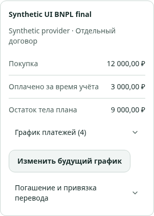
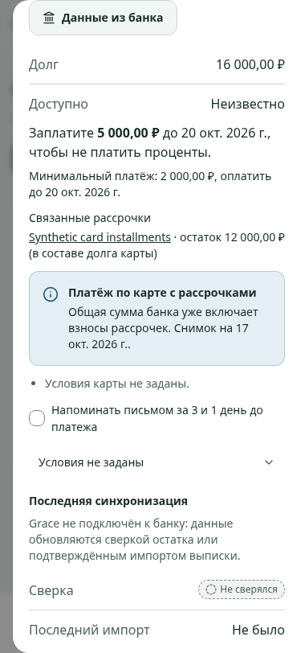
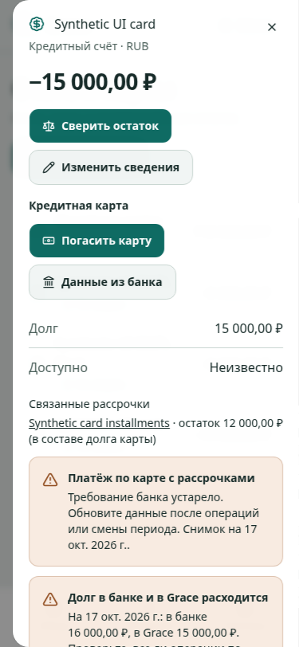

# SPEC-0054: реализация и проверка

Дата: 2026-10-17. Основание — [принятая SPEC-0054](0054-installments-bnpl.md),
PR #59, `main` `7bae8eb`. Владелец поручил разработку после передачи draft.
Ветка: `codex/installments-bnpl`. Статус: `integrated`; код влит в `main` через PR #60
(`a89a855a8074e4bd0fc957f72b2cb6ab807624fc`, 2026-10-17),
локальные post-merge gates пройдены 2026-10-18. Production-выпуск не подтверждён.

## Результат

- `internal/installments`: планы поверх obligation, связь с новой или
  существующей purchase, исторический остаток, распределение одного перевода
  по нескольким строкам, ревизии и история, сохраняемые копии графиков.
- Миграция 000026: составные owner FK, FORCE RLS, сериализация финансовых
  записей, ограничения переплаты/повторного использования credit, запрет
  изменения оплаченных строк, защита void/refund и дат до наблюдения.
  Для legacy-графиков сохраняется уникальность дат. Down отказывается удалять
  финансовую историю.
- Карты: подтверждённое общее требование банка, явное включение рассрочек
  и минимума, контроль актуальности после операций/правок. Полностью оплаченный
  план перестаёт требовать специального банковского подтверждения.
- Аналитика: покупка учитывается один раз, погашенное тело показывается
  справочно; `cardRequirements` содержит каноническую сумму и ссылки на счёт
  и снимок. Неполный горизонт и история до наблюдения дают явную неполноту.
  Денежная позиция сохраняет существующий смысл текущей ликвидности.
- Web: создание с подтверждением, исторический договор, запись и выбор
  перевода, распределение и история, копия графика с продолжением после
  закрытия формы, связи в карточках покупки и счёта, данные банка и статистика.
- Браузерная проверка выявила отсутствующий PUT в CORS development API.
  Добавлен PUT для настроенных origins и тест отказа для другого origin.
- [Инструкция владельцу](../installments-user-guide.md).

## Критерии приёмки

Все тестовые данные синтетические. Таблица содержит исполняемые свидетельства,
а не только соответствие текста реализации тексту спецификации.

| AC | Свидетельство | Результат |
| --- | --- | --- |
| AC1 | `TestPurchaseDebtAndAllocations`: purchase 12 000 ₽, четыре перевода по 3 000 ₽, расход 12 000 ₽, доход/debt_payment 0 ₽, погашенное тело 12 000 ₽, долг 0 ₽; повтор/конфликт ключа, atomic rollback неверного первого взноса | пройдено |
| AC2 | `TestHistoricalAndScheduleRevision`: остаток 9 000 ₽ без прошлых событий; неизвестный совокупный остаток до наблюдения, неполная денежная позиция; общая запись событий до даты наблюдения отклоняется | пройдено |
| AC3 | `TestExistingPurchaseLinkDoesNotCreatePostings`: привязка сохраняет одну purchase и одну проводку, повторная связь — 409; `TestCardRequirementsAndNoDuplicateDebt` проверяет долг карты | пройдено |
| AC4 | `TestConcurrentTransferAndDirectSQLGuards`: один победитель конкурентного распределения, SQL не превышает credit/строку; снятие связи сохраняет историю. `TestExistingPurchaseLinkDoesNotCreatePostings`: один перевод закрывает четыре строки | пройдено |
| AC5 | `TestCanonicalBankRequirement`, `TestCardRequirementsAndNoDuplicateDebt`: общее требование 5 000 ₽ и включённый минимум 2 000 ₽ дают итог 5 000 ₽; карточный график не добавляется повторно, в ответе указан счёт-источник | пройдено |
| AC6 | Карточная интеграция: операция того же дня после подтверждения делает требование устаревшим; будущий снимок отклоняется. Нулевой долг после полного погашения возвращает обычный режим карты. Прежние `internal/creditcards` suites также пройдены | пройдено |
| AC7 | Карточная интеграция: доступно 15 000 ₽ из 20 000 ₽ после общего требования 5 000 ₽; расширенный горизонт даёт null и причину. Standalone после всех оплат не оставляет обязательств | пройдено |
| AC8 | Интеграции: чужой план недоступен даже admin, прямой SELECT под RLS не раскрывает его; refund отклоняется; paid-row нельзя изменить через применение копии или SQL. Все legacy integration suites пройдены | пройдено |
| AC9 | `TestPaidInstallmentCancelsPendingReminder`: оплаченный взнос отменяет pending. `TestCardPlansShareOneReminderAndStaleSnapshotCancels`: два плана дают одно письмо карты, устаревший снимок отменяет следующий pending; отправитель — fake | пройдено |
| AC10 | Web: 327 тестов, включая новые проверки успешной инвалидации, сохранения кэшей при отказе, сохранения ввода при 409 и отбора планов по счёту перевода. Реальный browser flow описан ниже | пройдено |
| AC11 | OpenAPI и `schema.d.ts` обновлены; свежая миграция и отказ down проверены; общие gates, FSD, lint, форматирование и build пройдены | пройдено |

Go unit/integration tests — `internal/installments/*_test.go`; дополнительные
изменённые проверки — `internal/platform/httpserver/server_test.go`.
Новые web-тесты — `features/installment/manage/api/use-installments.test.tsx`
и `ui/InstallmentAllocationSection.test.tsx`.

## Команды и среда

- `make test` — exit 0: Go, 85 web-файлов / 327 тестов, ESLint, Steiger,
  Prettier, сборка без предупреждения о 500 кБ, Jev datasets v1/v2.
- `make test-integration` — exit 0: все 14 наборов, включая новый
  `scripts/test-installments.sh` и прежние 13 наборов.
- После финальных уточнений: повторный `scripts/test-installments.sh` на
  свежей БД — exit 0; затронутые `analytics`, `httpserver`, `installments`
  unit checks и `installments`/`commitments` integration checks — exit 0.
- `git diff --check` — чисто. Внешние платные API и настоящая почта не нужны.

В managed cloud установлен Go 1.24.13. Go unit gates запускались в контейнере
с тем же toolchain и исходниками: среда подставляет `.git` в `/tmp`, из-за чего
прежние import-review tests корректно отказываются писать там отчёт. Изоляция
контейнерного `/tmp` устраняет это ограничение без изменения продукта/тестов.
Node и PostgreSQL integration tests запускались штатно. Для существующих
Docker build suites использованы временные BUILDX_CONFIG в `/tmp` и secret-mount
системного CA в шаг загрузки модулей; production Dockerfile и credentials
не менялись, проверка TLS оставалась включённой.

## Проверка в браузере

Chromium, локальные Vite/API/PostgreSQL, development owner, ширина 375 px:

1. Через форму создана purchase 12 000 ₽, четыре строки по 3 000 ₽ и первый
   взнос. Карточка показывает оплачено 3 000 ₽, остаток 9 000 ₽.
2. Создана копия графика, оплаченная строка недоступна для редактирования;
   дата будущей строки изменена, копия сохранена и применена.
3. В карточке карты через «Данные из банка» введены общая сумма 5 000 ₽,
   минимум 2 000 ₽, включённый взнос 1 000 ₽ и подтверждение охвата операций.
   Grace показывает общий платёж 5 000 ₽ и источник.
4. После нового перевода требование становится устаревшим; сообщения
   «Льготный период сохранён» нет. Горизонтальная прокрутка отсутствует,
   ошибок консоли нет. Отдельно проверено отсутствие противоречивой пустой
   карточки обязательств при наличии новых планов.

Все формы имеют подписи, клавиатурные controls из существующей системы и
элементы высотой 44 px; web-тест взаимодействия использует те же controls.

## Границы выпуска

- Реальные правила Сплит/Долями/конкретных банков не проверены: провайдер,
  суммы и даты вводятся владельцем. Тесты не объявляются банковским справочником.
- Только беспроцентный v1: комиссия записывается отдельным расходом;
  капитализация, платное продление и возврат связанной покупки требуют
  отдельного scope. Старые графики и покупки автоматически не мигрируют.
- Банковское требование обновляется вручную после операций. Разные даты
  грейса/минимума и неподтверждённое включение не дают точного общего итога.
- Последний успешный Deploy production — `95c5fa8` (run 39034114035).
  Merge SPEC-0054 подтверждён PR #60; успешные CI и deployment
  этой реализации не подтверждены. Merge не означает production-выпуск.

## Post-merge verification — 2026-10-18

Проверяемый `main`: `a89a855a8074e4bd0fc957f72b2cb6ab807624fc`.
Изменения продукта при проверке не вносились.

- `make test` — exit 0: Go, 85 web-файлов / 327 тестов, ESLint,
  Steiger, Prettier, генерация OpenAPI types, TypeScript/Vite build,
  Jev datasets v1 (49) / v2 (72). Основной JS chunk 390.04 kB.
- `git diff --check` — exit 0; рабочая копия `main` чистая.
- `make test-production` — exit 0: rollout reminders, production bundle,
  off-site backup с синтетическим S3, шифрование/отказы/восстановление.
- `go vet ./cmd/... ./internal/...` — exit 0.
- `make test-integration` — exit 0: все 14 наборов, включая installments,
  commitments/creditcards/loans, UX, password auth, AI drafts, imports,
  ownership, financial events, receipts, obligations, analytics и assistant.
  Отказы down-миграций с финансовыми данными — ожидаемые негативные проверки.
- [CI run 39056633511](https://github.com/QahNaaRlN/grace/actions/runs/39056633511):
  quality job не стартовал из-за failed account payments или spending limit;
  integration и builds пропущены. Это не результат тестов продукта.
- [Delivery run 39056638931](https://github.com/QahNaaRlN/grace/actions/runs/39056638931):
  failure; публикация images пропущена.
- Последний успешный [Deploy production run 39034114035](https://github.com/QahNaaRlN/grace/actions/runs/39034114035)
  относится к `95c5fa8`; live runtime VPS в этой проверке не инспектировался.

Статус `integrated` опирается на достижимость implementation из `main`
и завершённые локальные post-merge gates согласно `docs/specs/README.md`.
Он не означает успешный GitHub CI или production deployment.

Следующий gate: восстановить GitHub Actions и получить успешные CI/Delivery
для выбранного release SHA.
Production deployment выполняется отдельно; новые банковские правила,
платные API и изменения финансовых данных в этот пакет не входят.
