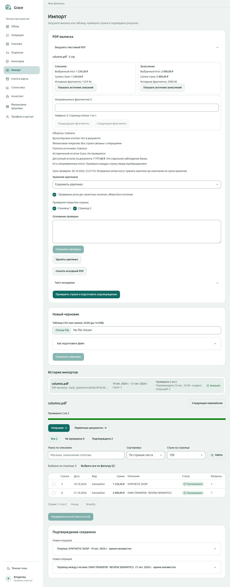
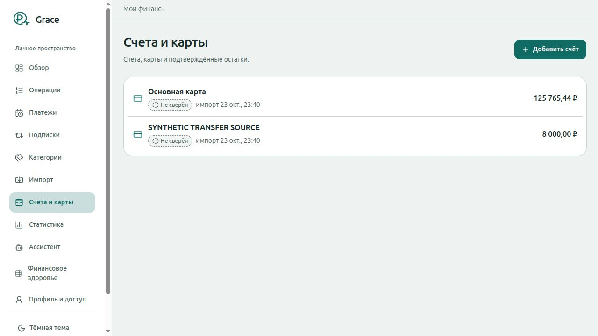

# SPEC-0055 — полный ручной импорт публичного PDF в браузере

Основание: [принятая SPEC-0055](0055-bank-statement-pdf-import.md), AC2–AC6,
AC9/AC10 в пределах сценария ниже. Проверка Codex от 2026-10-23; это
исполнительское evidence, не самостоятельная функциональная приёмка владельца.
Производственный код не менялся.

Проверен source `29792809f5e6435c93fe07a5170e7ed7135d38ca` на настоящих built
API/Web images и PostgreSQL с fresh migrations. Код продукта совпадает с main
`989918237babaff499cadf319f4be2fd32a10ec0` после принятого отчёта PR111;
между ними изменились только docs/закрытые метрики S1.20.
Worktree: `statement-manual-import-e2e`, branch `codex/statement-manual-import-e2e`.

## Среда и воспроизведение

Собственный disposable Compose project `grace-manual-e2e-20261023`, отдельная
пустая БД с dev seed; web/API доступны только через localhost 58273/58280.
Docker network internal=true, pinned pdf helper network=none, read-only,
uid10001, mem512MiB/pids16. Все AI flags=false, provider keys пусты.
Production, личные PDF и чужие Docker проекты не использовались.

1. Через форму загрузить публичный `internal/pdfextract/testdata/columns.pdf`
   в счёт «Основная карта» (opening125000 RUB). Две страницы, две операции. SHA256 файла:
   `097c3d35d4dd9787457b13f61bd524ff83c18d969ce50b93f7c8cecfeb569c8c`.
2. Ручными выборами spans задать даты операции/проводки19/20 и21/22 октября,
   account amounts -1234.56/+2000 RUB, original -15 USD отдельно, описания
   `SYNTHETIC SHOP` и `OWN TRANSFER - REVIEW SEMANTICS` целиком, включая дефис.
   Available7777 RUB оставить отдельным наблюдением. Debit1234.56 и credit2000
   задать как обороты; остатки book не изобретать. Остальные19 служебных spans
   явно отметить проверенными группами с основанием. Unmapped0, source/turnover matched.
3. После materialization явно загрузить актуальную owner review, заново
   подтвердить роли/обе страницы, указать основание. Выбрать keep original,
   сохранить проверку. Проверка старой версии не переносится автоматически.
4. В UI создать второй синтетический счёт `SYNTHETIC TRANSFER SOURCE`,
   opening10000 RUB. Для первой строки сохранить purchase123456 minor RUB;
   для второй internal_transfer200000 minor RUB из второго счёта в основной,
   с явным подтверждением финансового смысла. Даты без вымышленного времени.
5. Выбрать обе строки, открыть preview: create2/link0/exclude0;
   изменения +76544 minor основному счёту, -200000 второму. До подтверждения
   проверить SQL counts. Нажать финальное подтверждение в тестовой БД.
6. Перезагрузить страницу с confirmation; проверить receipt, обе confirmed
   строки, accounts и SQL. Через форму ещё раз загрузить тот же PDF в тот же
   счёт; открыть историю, проверить прежний source/batch и неизменные counts.

Первый доступ через объявленные Docker ports вернул connection refused:
internal network не опубликовала ports. Собственный временный localhost TCP
forward к IP только этого стека сохранил изоляцию. Это настройка стенда,
не дефект Grace. Host node_modules не монтировались в runtime.

## Фактические результаты и AC

| Критерий | Исполняемая проверка / наблюдение | Результат |
| --- | --- | --- |
| AC2, AC9 | Upload→mapping→owner review→решения→preview; прямой SQL только своей БД | events0/postings0/attempts0/calls0, decisions2 |
| AC3 | Available7777 отдельно, book отсутствует, originalUSD отдельно; UI preview и integer postings | PASS только этого layout |
| AC5 | Purchase + входящая сторона собственного transfer; receipt и SQL kind/posting/account | purchase1/internal_transfer1/income_received0; postings3 |
| AC6 | Confirmation→reload→повтор того же PDF через форму→history | confirmation1, events2/postings3/provenance2, source1/batch1/records2; confirmed строки disabled |
| AC10 | Полная разметка обеих страниц и явная актуальная owner review | unmapped0/source matched, после confirm financial coverage «Все строки связаны с операциями» |
| AC4 | Идентичный PDF не дублирует факт | PASS узкого same-file сценария; regenerated PDF/Receipt и повторная сторона transfer здесь не проверялись |

[До confirm](../research/statement-quality/manual-import-ui/before-confirm.json),
[после confirm](../research/statement-quality/manual-import-ui/after-confirm.json),
[после повторной загрузки](../research/statement-quality/manual-import-ui/after-repeat.json)
— JSON результата SELECT counts/aggregate в собственной БД, без правок таблиц.
После каждого указанного этапа counts читаются командой (стек должен быть поднят):

```sh
docker compose -p grace-manual-e2e-20261023 -f /tmp/grace-manual-e2e-compose.yaml \
  exec -T postgres psql -U grace -d grace -Atqc "SELECT json_build_object(
  'events',(SELECT count(*) FROM financial_events),
  'postings',(SELECT count(*) FROM postings),
  'attempts',(SELECT count(*) FROM statement_extraction_attempts),
  'calls',(SELECT count(*) FROM statement_extraction_calls),
  'confirmations',(SELECT count(*) FROM import_confirmations),
  'provenance',(SELECT count(*) FROM import_provenance),
  'sources',(SELECT count(*) FROM statement_sources),
  'batches',(SELECT count(*) FROM import_batches),
  'records',(SELECT count(*) FROM import_records));"
```

В той же psql session баланс проверяется детерминированным SELECT:

```sql
SELECT a.name, a.currency, a.opening_balance_minor,
  a.opening_balance_minor + COALESCE(SUM(CASE WHEN p.direction = 'credit'
    THEN p.amount_minor ELSE -p.amount_minor END), 0) AS balance_minor
FROM accounts a LEFT JOIN postings p ON p.account_id = a.id
GROUP BY a.id ORDER BY a.name;
SELECT kind, count(*) FROM financial_events GROUP BY kind;
```

Остатки: основной12576544 minor RUB =125765.44 RUB
(125000−1234.56+2000), второй800000 minor RUB =8000 RUB (10000−2000).
Opening values не заменены available balance; оба счёта остаются «Не сверён».
Историческая сверка not_evaluated и отсутствие book balances сохранены.
Общее предупреждение о непроверенных итогах при этом остаётся в UI.

Statement `6658cc9f-8e58-4bb4-82af-a4807fc363f6`,
batch `fa344cb4-d4cf-46c0-8c5c-d025a50b32e4`,
confirmation `0a85250e-d241-42ae-bc9c-18be863a27d6` — одноразовые тестовые UUID.





## Границы доказательства

Это успешный manual path одного публичного двухстраничного layout без LLM.
Параллельные confirms, потеря ответа, atomic rollback, regenerated PDF/Receipt,
второй owner и мобильная ширина в этом прогоне не воспроизводились;
их существующие integration/browser evidence не объявляются новым PASS.
Надёжный AI draft, representative qualification, реальный банковский образец
и owner functional acceptance этой проверкой не доказаны. Сохранённый S1.19
REJECT не меняется; R4 CONSUMED, repair/pilot/SSH/deploy не открыты.

В консоли нет errors; остаётся существующий warning `HydrateFallback`.
Рабочие вкладки закрыты. Две ранние error-вкладки не удалось привязать для
ручного закрытия из-за browser URL policy; они временные и не сохранены как handoff.
Собственный localhost forward остановлен, Compose down -v удалил все5 containers,
оба named volumes и network. Выборки по project label для containers/volumes/networks пусты.

## Проверки перед публикацией

`make test` PASS: Go,89 Web suites/336 tests, lint/FSD/format/build и offline Jev;
`/tmp/grace-manual-make-test.log`. Private TMPDIR в /var/tmp удалён trap.
Первый запуск остановился на отсутствующем Vitest в новом worktree;
после подключения существующих host dependencies полный повтор PASS.
`go vet ./cmd/... ./internal/...` PASS (`/tmp/grace-manual-vet.log`),
`git diff --check` PASS. API/OpenAPI/types и весь исполняемый код не менялись.

Интеграция принятого отчёта PR111 на main9899182 независимо проверена:
[CI40004726687](https://github.com/QahNaaRlN/grace/actions/runs/40004726687)
5/5 exact-source/all-jobs PASS и
[Delivery40005956714](https://github.com/QahNaaRlN/grace/actions/runs/40005956714)
4/4 PASS, включая guard и три published images. Это автоматическая публикация
images, не deploy. Product tree совпадает с проверенным UI source2979280.
Собственный повтор полного `make test-integration` хранит лог
`/tmp/grace-manual-integration.log`; его итог указывается в PR после завершения,
не выводится из одного успешного UI-сценария.

